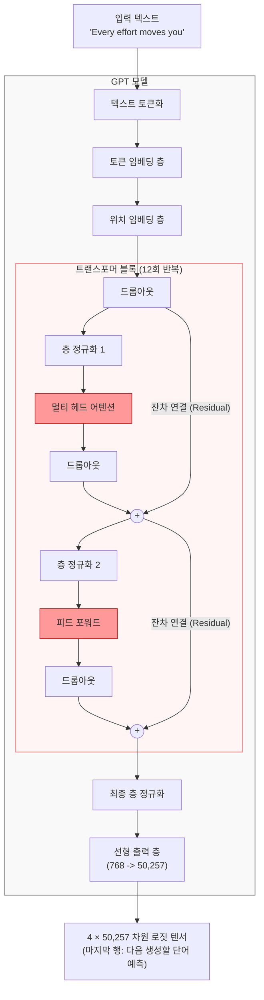

# AI 모델과 GPT 모델 이해

## word Encoding
위치 임베딩은 토큰 임베딩과 크기가 같아야 함. (행렬 합을 해야 하기 때문에)
절대 위치 임베딩은 잘 이해 안됨. (sinusoidal positional encoding)
상대 위치 임데빙이 스텝마다 변한다는 의미가 뭔지?
ROPE - 단어를 회전 하낟고 하는데. 그 의미가 무엇인지??

## Token
Special Token : 특수한 문장의 의미등을 넣어서 활용하는 용도.
Self-supervised dataset 은 한단어 다음을 타킷으로 삼아서 생성하는 방식임.

## attention
문맥을 활용하여 뒤에 올 단어에 따른 확률 값을 더하는 것임. (반영할 확률값은 어디서?? => softmax 의 결과값)
self-attention 은 나 자신과 비교하는 것임. 
## Q,K,V
Q (query) : 질문을 던지는 주체
K (Key) : 질문에 답하는 대상
V (Value) : 전달할 정보

Q, K를 분리하지 않으면 Attention이 제대로 되지 않음
자기 자신이 항상 내적의 최대값이 되고, 순서 변경해도 이를 인지 할기 어려움

K,V를 분리하지 않으면 의미가 섞일 수 있음
Key 는 어디를 볼지 를 정하는 검색용 단어
Value 는 무엇을 가져올지 정하는 실제 정보

## masking
미래 토큰을 알수 없음으로 현재까지의 토큰으로만 Attention score 를 계산하기 위함

## Multi-head Attention 
?? 이해 필요, 각각의 관점에서 보는 것이라는 데 잘 이해 안됨
따로 공부 필요. 

GPT 모델은 아래와 같은 구조를 가짐. 
    표준 트랜스포머 블록 (Decoder Block)
    구조: LayerNorm -> Attention -> Add(Residual) -> LayerNorm -> FeedForward -> Add(Residual)
여기서 attention 구조와 FeedForward 의 동작을 정확히 이해 해야 한다.
그리고 최종 GPT 코드를 어떻게 구조가 되는지가 이해 되어야 함.
전체 GPT 모델 구조 정의
    Embedding (토큰 -> 위치 -> dropout ) -> Transformer Blocks -> Final Norm -> Output Head

## 지식의 저장
FFN ?? 어떤 의미인지? 잘 이해 안됨.
새로운 Layer로 가면서 새로운 정보들이 만들어짐. (중첩적인 의미)

## 시계열 데이터
시계열 데이터도 LLM(transfer model) 모델을 통한 예측을 시도하는 것이 도전되고 있음

# 2일차 모델 학습
## dataset
validation dataset 을 사용하는 이유 : 모델의 overfitting 되는 것을 확인 하는 용도 임
- 비용 함수
  - 수치 예측(MSE) (실제값과 측정값의 차이 분산)
  - 이진분류 (Cross Entropy): 일정 기준이상이면 1 로 분류
    낮은 확률의 값을 1로 올려야 한다? 어떻게?
  - 정답 토큰들의 로그 확률을 구해서 평균을 구한후 부여

- 가중치 모델
  - 경사 하강법 (Gradient Descent): Loss를 최소화 하기 위해 가중치 찾는 방법(optimizer)
    이 방식의 문제는 낮은 골에 빠지는 문제가 생김 
  - Adam Optimizer: 과거 기울기 변화량을 추정하고, 각 파라미터마다 학습률을 다르게 조정 (관성을 적용)
    기울기가 완만하면 step size 는 크게, 기울기가 급하면 step size 를 작게 하여 속도를 조정
    Adam은 기울기의 방향을 담은 모멘텀과, 파라미터별 보폭 조절값을 함께 사용해 가중치를 업데이트한다.

## fine tuning 개념
input 이 짧은 경우 padding token을 사용하여 길이를 맞추도록 해야 한다.
분류의 마지막 출력 layer 에서 0,1 두개 분류로 되도록 수정
그리고 제일 마지막 block 부분만 수행. (기존 지식은 보존한 상태에서 튜닝 하기 위함)

## LoRA
별도의 Adapter 만 두고 튜닝 하는 방법
주요 용도는 응답 스타일이나 지시 이행 등의 영역에 사용.
지식 자체를 망각될 위험이 매우 낮음
필요에 따라 LoRA Adapter 를 머지 해서 선택적으로 사용 할수도 있는 장점이 있음
행렬 A는 랜덤으로 행렬 B 는 0 으로 초기화 , 이렇게 되면 첫번째 역전파에서 B 만 업데이트 됨( 그러나 이해가 안됨)

## QLoRA 
양자화 된 값으로 LoRA를 하는 것
scale 된 Factor들도 양장화를 해야 한다.

## 지시 미세 튜닝
현재 사용하는 방식에서 target 은 next token 부터 끝까지가 대상임.
추론하는 부분을 제외 하고 masking 을 해야 한다. (padding 이나 첫 부분등)

## RLHF or DPO
사람이 선호 하는 답변을 하도록 feedback 하면서 가르치는 방법
사람이 선호하는 것처럼 평가를 하는 모델이 reward model 임. (PPO), 사람은 우선순위만을 선정함
이 사람이 선호도를 학습 하는 것 대신, 데이터로만 사람의 선호도를 학습하는 방식
kL Divergrence ?? 의미 확인 필요. 개념적으로는 유사하게 되면 값이 작은 것임

SFT 는 모델 하나만 사용
  입력과 출력을 받음

정책 모델만 역전파와 순전파를 적용 함

DPO 는 한 데이터에 대해서 4번 추론을 하게 됨.
    선호/비선호 응답을 배치로 합침

## 추론 응답
응답의 step 별로 advantage 를 부여 하는 점수 규칙으로 점수 부여후 loss 를 계산하도록 한다.

MLA 를 현재 우리가 사용하는 모델에 적용이 되어 있는지 확인 필요
GPU 자원을 줄일수 있는지?

MLA/ Flash attention / TurboQuant 등의 수식은 전혀 이해가 안됨.
개념 자체는 알겠음.

MOE feedforward 에서 최적화 하는 방법 임.
Gemma4 에는 PLE (Pre-Layer Embeddings 가 적용 되어 있음 , E4B 모델이 이것임)
PLE 는 어떤 특징? 
